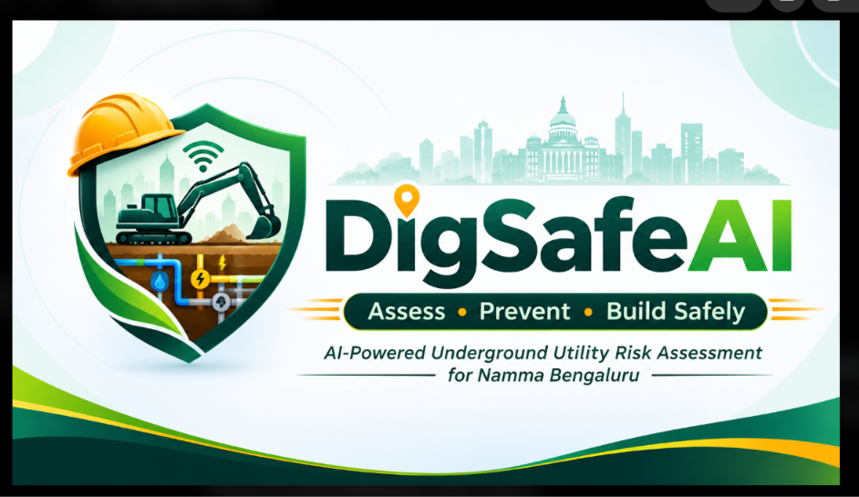
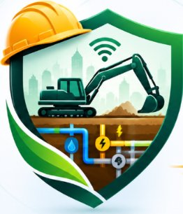
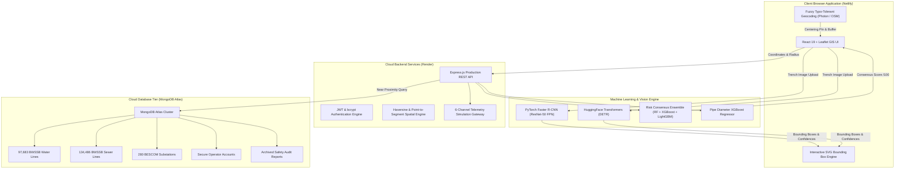

<div align="center">

<p align="center">
  
</p>

#  DigSafeAI

### **Intelligent Underground Infrastructure Safety & Autonomous Subsurface Risk Screening**
*Real-Time Municipal GIS Proximity • Deep Learning Vision Inspection • 6-Channel Telemetry Consensus*

[](https://digsafeai.netlify.app)
[](https://digsafeai-project.onrender.com/health)
[-47A248?style=for-the-badge&logo=mongodb&logoColor=white)](https://www.mongodb.com/atlas)
[](https://pytorch.org/)
[](https://scikit-learn.org/)
[](https://react.dev/)

<p align="center">
  <b>DigSafeAI</b> is an enterprise-grade civil engineering decision-support platform engineered for <b>Namma Bengaluru</b> to prevent catastrophic subsurface utility strikes during roadway, metro, and urban trench excavations.
</p>

---

[🌐 Live Web Application](https://digsafeai.netlify.app) • [📖 System Architecture](#-system-architecture) • [⚡ 3-Pillar Input Model](#-the-3-core-inputs--hazard-consensus-model) • [🚀 Quickstart](#-quickstart-guide) • [📡 API Reference](#-api-endpoints)

---

</div>

<br/>

## 🎯 Platform Highlights

<table>
<tr>
<td width="50%">

### 🗺️ Real-Time Municipal GIS Vector Mapping
* Ingests **232,449 real municipal records** directly loaded into MongoDB Atlas:
  * 💧 **97,683** BWSSB Water pipelines & feeder conduits
  * 🪨 **134,486** BWSSB Sewer trunk lines & storm connections
  * ⚡ **280** BESCOM Substation assets & power corridors
* **Fuzzy Geocoding with Typo Tolerance:** Instant typeahead searches across Bengaluru (e.g. *Alliance University, Indiranagar, Whitefield, Koramangala*) with real-time radial buffer zone rendering.
* Point-to-segment distance calculations with nominal diameter estimation ($R^2 = 0.665$, MAE $17.6\text{mm}$).

</td>
<td width="50%">

### 👁️ Deep Learning Surface Vision Inspection
* **Specialized Subsurface Object Detection:**
  * Powered by **PyTorch ResNet-50 FPN (Faster R-CNN)** and **DETR** architectures.
  * Detects exposed water mains, gas pipelines, electrical sleeves, and telecommunication conduits.
* **Strict Civil Domain Verification Gate:**
  * Enforces **Zero False Positives**: Rejects everyday photos (people, faces, vehicles, animals, documents, signatures, indoor scenes).
  * Automatically returns:
    > *"No utility object detected from the surface."*
  * Only genuine excavation trenches and exposed utility infrastructure trigger bounding boxes and confidence metrics.

</td>
</tr>
<tr>
<td width="50%">

### 🔬 6-Channel Subsurface Telemetry Simulation
* Models physical trench wall stability and subterranean acoustics:
  * 📳 **Vibration Index:** Evaluates heavy machine tonnage impact
  * 🔊 **Acoustic Resonance (dB):** Detects pipe resonance & pressurization
  * 💧 **Soil Moisture:** Analyzes saturation, liquefaction & cave-in risk
  * 🌡️ **Soil Temperature:** Assesses ground horizon thermal profiles
  * ☣️ **Hazardous Gas (ppm):** Scans for anaerobic methane & $H_2S$ pockets
  * 📐 **Ground Displacement (mm):** Evaluates shoring box lateral movement

</td>
<td width="50%">

### 🛡️ Safety-First Multi-Model Consensus Engine
* Combines **Mathematical Physics** with a multi-model ML ensemble:
  * 🌲 **Random Forest Classifier**
  * ⚡ **XGBoost Classifier**
  * 💡 **LightGBM Classifier**
* **Strict Non-Downgrade Protocol:** An AI model can escalate a risk to **HIGH**, but will never downgrade a mathematically dangerous site.
* Generates official downloadable **Engineering Audit PDF Reports** with digital verification stamps and field safety checklists.

</td>
</tr>
</table>

---

## 🏗️ System Architecture



---

## ⚡ The 3 Core Inputs & Hazard Consensus Model

DigSafeAI strictly combines **3 distinct operational inputs** to calculate the transparent, certified **Integrated Hazard Score ($H$)**:

```
                  ┌────────────────────────────────────────────────────────┐
                  │                 Proposed Excavation Site                │
                  └──────────────────────────┬─────────────────────────────┘
                                             │
      ┌──────────────────────────────────────┼──────────────────────────────────────┐
      ▼                                      ▼                                      ▼
[ 1. Geospatial Footprint ]          [ 2. Site Image AI ]               [ 3. Telemetry Simulation ]
• Lat / Long Coordinates             • PyTorch Faster R-CNN             • Ground Vibration (V)
• Planned Depth (D in meters)        • DETR Neural Network              • Acoustic Resonance (A)
• Search Radius Buffer (m)           • Exposed Pipe & Conduit BBox      • Soil Moisture & Saturation (M)
• Nearest Municipal Pipe (P)         • Zero False-Positive Gate         • Hazardous Subsurface Gas (G)
      │                                      │                                      │
      └──────────────────────────────────────┼──────────────────────────────────────┘
                                             │
                                             ▼
                     ╔═══════════════════════════════════════════════╗
                     ║           INTEGRATED HAZARD FORMULA           ║
                     ║                                               ║
                     ║    H = 0.50*P + 0.20*D + 0.15*V + 0.10*M + 0.05*G   ║
                     ╚═══════════════════════════════════════════════╝
                                             │
                                             ▼
                             FINAL AUDITED RISK CLASSIFICATION
                     ┌───────────────────────┬───────────────────────┐
                     │  Score: 0.00 to 0.33  │  🟢 LOW RISK          │
                     │  Score: 0.34 to 0.66  │  🟡 MEDIUM RISK       │
                     │  Score: 0.67 to 1.00  │  🔴 HIGH RISK         │
                     └───────────────────────┴───────────────────────┘
                                             │
                                             ▼
                              Official Engineering PDF Export
```

### Formula Weighting Breakdown
* **Pipeline Proximity ($P$ – 50% Weight):** Measures distance to the closest verified municipal transmission line. If unmapped, a cautious factor ($0.50$) is applied to account for unrecorded conduits.
* **Excavation Depth ($D$ – 20% Weight):** Standard utility burial horizons are $1.2\text{m} - 2.5\text{m}$. Deeper trenching escalates structural pressure and strike risk.
* **Ground Vibration ($V$ – 15% Weight):** High machine impact can shatter cast-iron mains or trigger trench wall liquefaction.
* **Soil Moisture ($M$ – 10% Weight):** High moisture flags trench wall softening, seepage, and collapse risk.
* **Subsurface Gas ($G$ – 5% Weight):** Detects anaerobic sewer gases ($H_2S$) or volatile pipeline leaks.

---

## 📂 Repository Structure

```
DigSafeAI_Project/
├── docs/
│   └── images/
│       ├── digsafe-banner-official.png Official login & platform banner
│       └── digsafe-shield-logo.png     Official emerald & navy shield logo
├── backend/
│   ├── lib/
│   │   ├── config.js                 Runtime environment validation
│   │   ├── diameterModelPredictor.js AI pipe diameter regressor
│   │   ├── geospatial.js             Haversine and point-to-segment math
│   │   ├── hazardScoring.js          Integrated multi-factor formula engine
│   │   ├── modelRegistry.js          ML model artifact state & registry
│   │   └── utilityProximity.js       Municipal spatial index queries
│   ├── ml/
│   │   ├── faster_rcnn_inference.py  PyTorch Faster R-CNN inference adapter
│   │   ├── detr_inference.py         HuggingFace DETR inference adapter
│   │   ├── vision_feature_engine.py  Domain-gated utility inspection engine
│   │   ├── inference_service.py      RF + XGBoost + LightGBM consensus
│   │   ├── models/                   Trained ML models (RF, XGB, LGBM, Scalers)
│   │   └── vision/                   Faster R-CNN chunked weights & DETR models
│   ├── models/                       Mongoose Schemas (User, Utility, RiskResult, etc.)
│   ├── routes/                       Auth, Utility, Risk, Simulation, Model Routes
│   └── server.js                     Express entry point with CORS & rate-limiting
├── frontend/
│   ├── public/
│   │   ├── digsafe-banner-official.png Official high-res login banner
│   │   ├── digsafe-shield-logo.png     Official vector shield logo
│   │   └── samples/                    Reference excavation imagery
│   ├── src/
│   │   ├── components/               Navbar, Sidebar, Logo components
│   │   ├── pages/
│   │   │   ├── MapAnalysis.jsx       Interactive 5-step spatial safety workflow
│   │   │   ├── DataSources.jsx       Provenance catalog (232K+ Atlas records)
│   │   │   ├── Dashboard.jsx         Operator overview & recent audits
│   │   │   ├── Reports.jsx           PDF generation & audit archives
│   │   │   ├── Login.jsx / Signup.jsx Operator authentication
│   │   │   └── About.jsx             Engineering specs & operational guidelines
│   │   └── services/api.js           Axios interceptors & multi-host routing
│   └── index.html                    Root document with security guards
└── Datasets/                         Bengaluru open GIS spatial layers (BWSSB, BESCOM)
```

---

## 🚀 Quickstart Guide

### 1. Prerequisites
* **Node.js:** `v18.0+`
* **Python:** `3.10+` with PyTorch & torchvision
* **MongoDB:** Local instance or [MongoDB Atlas](https://www.mongodb.com/atlas) connection string

### 2. Environment Configuration
Create `backend/.env`:
```env
PORT=5000
MONGO_URI=mongodb+srv://<username>:<password>@cluster.mongodb.net/test?retryWrites=true&w=majority
JWT_SECRET=your-32-character-secure-production-jwt-secret-key
CORS_ORIGINS=http://localhost:5173,https://digsafeai.netlify.app
MAX_REQUEST_SIZE=10mb
PYTHON_EXECUTABLE=python
```

### 3. Local Installation & Startup

```powershell
# 1. Install & start Backend
cd backend
npm install
node server.js

# 2. In a separate terminal, install & start Frontend
cd frontend
npm install
npm run dev
```
Open [http://localhost:5173](http://localhost:5173) in your browser.

---

## 📡 API Endpoints

All protected endpoints require an `Authorization: Bearer <JWT>` header.

| Method | Endpoint | Description |
|:---:|:---|:---|
| `GET` | `/health` | Cloud health & MongoDB Atlas connectivity status |
| `POST` | `/api/auth/signup` | Register new certified operator account |
| `POST` | `/api/auth/login` | Authenticate operator & receive JWT token |
| `GET` | `/api/utilities/summary` | Live count of mapped municipal utilities (232K+ records) |
| `GET` | `/api/utilities/nearby` | Radial spatial search (`lat`, `lng`, `radius`, `type`) |
| `POST` | `/api/models/image-inference`| Upload excavation photo $\to$ PyTorch vision inspection |
| `POST` | `/api/simulation/simulate` | Generate 6-channel synchronized telemetry readings |
| `POST` | `/api/risk/analyze` | Run integrated consensus risk evaluation & save audit |
| `GET` | `/api/reports` | Retrieve saved historical risk assessments & PDF logs |

---

## 🔒 Safety & Operational Boundaries

> [!IMPORTANT]
> **Field Usage Notice:** DigSafeAI is an artificial intelligence and geospatial decision-support system. While backed by 232,000+ official municipal spatial vectors, unmapped private lines, legacy conduits, or recent utility realignments may not appear in government open-data files. Non-destructive physical potholing, pipe locators, and statutory liaison with **BWSSB** and **BESCOM** remains mandatory before breaking ground.

---

<div align="center">

Made with 💚 for **Namma Bengaluru Urban Safety** • 🛡️ **DigSafeAI Infrastructure Protection Network**

</div>
